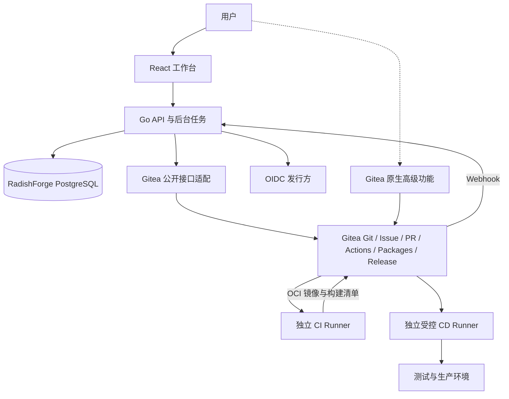

# 总体架构

状态：设计，尚未实现。采用模块化单体，首版只验收 Gitea；Forgejo 是后续独立适配目标。



## 组件与边界

| 组件 | 职责 | 不承担 |
| --- | --- | --- |
| React / TypeScript | 路由、交付视图、表单、可访问交互 | 保存上游 Token、直接读数据库 |
| Go 服务 | 会话、授权、聚合、发布与部署编排、审计 | Git 协议、通用流水线执行器 |
| PostgreSQL | 自有事实、队列、幂等键、缓存及迁移 ledger | 复制 Gitea 业务库 |
| Gitea 适配层 | DTO 转换、能力检查、超时与错误映射 | 通用多底座插件框架、私有 API |
| Gitea | Git / Issue / PR / Actions / Packages / Release | RadishForge 跨组件发布意图 |
| Runner | 执行固定工作流、构建与部署任务 | 替工作台决定业务授权 |

前端建议 Vite、React Router、TanStack Query；后端以 Go 标准 HTTP 能力加轻量路由、pgx 起步，必要时引入 sqlc。版本在 M0 冻结。后台任务先使用 PostgreSQL 持久化和租约；不预置 Redis、Kafka 或微服务。

## 接口

工作台仅访问自有 `/api/v1`，由正式 OpenAPI 生成 TypeScript 客户端。外部兼容 API 使用独立入口 / 契约，不把自有业务 API 伪装成 GitHub；具体策略见[GitHub 兼容](github-compatibility.md)。

Git HTTP / SSH、OCI `/v2/` 及原生 Gitea 页面保持直接协议入口。建议工作台与 Gitea 独立 origin，避免路径重写破坏 Git、Registry、回调和附件 URL；最终域名由安装配置提供。前端运行时公开配置不能包含秘密。

## 状态同步

1. Webhook 在解析前按约定验证签名与体积，接收来源仅允许已登记底座。
2. 在确认持久化后返回成功，事件以底座标识、投递标识及有效载荷摘要去重。
3. 异步处理采用租约、有限重试、退避与失败队列；重复或乱序事件不能把终态改回运行中。
4. 关键状态以 API 重新查询，周期对账弥补丢失事件；记录同步水位和过期状态。
5. SSE 只传自有视图更新；断线重连后取快照，不宣称提供底座原生实时日志流。

用户写请求携带请求 ID，写意图先持久化。跨系统没有分布式事务：执行步骤记录已知结果，超时为未知结果，先查询对账再决定重试。不能保证上游不支持幂等的操作恰好执行一次。

## 安全和运行边界

缓存按底座 / 资源划分，返回前重新核验用户权限；上游故障时保留明确的只读陈旧提示，无法确定权限时拒绝读取私有缓存。用户操作使用用户授权，后台机器人仅执行明确获授权范围。

平台进程不挂载 Docker socket；CI 和持生产凭据的 CD 不共用信任域。仓库内容、Issue Markdown、工作流输出和日志均为外部输入，显示前处理 XSS、链接与敏感信息；下载、回调、底座地址和外链代理限制 SSRF。

## 未来源码布局

以下目录尚未创建，属于后续工程任务：

```text
apps/web/                  React 工作台
cmd/radishforge/            Go 入口（API、worker、迁移命令）
internal/identity/          会话、OIDC、绑定与授权
internal/projects/         项目、组件、仓库关联
internal/issues/           Issue 用例与上游调用
internal/builds/            构建查询与操作
internal/releases/         清单与发布编排
internal/deployments/      环境和部署意图
internal/events/           队列、事件与对账
internal/integrations/gitea/  上游公开协议适配
api/                       自有与兼容契约分开保存
migrations/                自有数据库迁移
integrations/gitea/custom/  品牌与导航扩展
deploy/                    容器、配置、发行锁定清单
tests/contracts/           真实上游契约样例
```

只在功能需要时建立模块。参见[数据模型](domain-model.md)、[身份](identity-access.md)与[交付链路](delivery-flow.md)。
